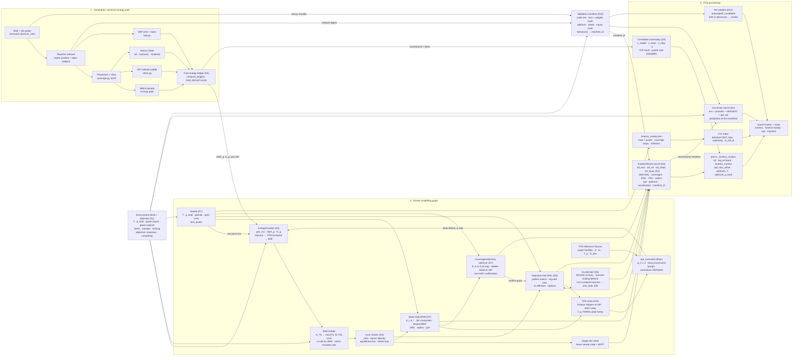

# Kinetics v2 for reaction pathways

Replace the single-site linear chain with one ledger, a site-balance MKM and a rejection-free KMC (MCAMC-accelerated), driven by a split input/output partial-pressure environment block, anchored to experimental TPD, optimised over T and total pressure, and re-runnable from one manifest.

Owner: catalysis-selectivity (thread file: Horizon 5a, next to
`electrochem-kinetics-beyond-che.md`). Engine work lands in catpath
(`~/catpath`, GPL-3) through chemistry's wheel-bump path; precis owns the
environment block, the job, the views, the manifest store and the quest
scalars. Revised 2026-10-19 after Reto's review (rulings in §Decisions).
Survey evidence: `perplexity-research:498166` (Novotny lineage), `:498168`
(rare events), `:498172` (BEP/scaling/BEEF), `:498185` (SSA variants and
codes), `:498187` (thermodynamic consistency), `:498244` (gas boundary
conditions), `:498670` (Pd(111)/alloy TPD reference data), `:498675` (TPD
analysis methods and DFT calibration), `:498677` (correlated uncertainty),
`:498682` (MCAMC algorithm, pitfalls, selection structures). Every claim
below that matters is pinned to a paper handle; where none was found the
text says so.

## Motivation / why

Today's kinetics (`autocatpath/kinetics.py::solve`, run by
`precis_pathway.runner.run_kinetics_subprocess` after every aggregate, 900 s
cap) is a **linear master equation over one site**: each network state is
one whole-cell configuration, a site is in exactly one state, and
`rate_matrix` is a generator matrix whose steady state is solved exactly by
`_linear_steady`. That is the zero-interaction, single-site Markov chain. It
gets detailed balance right (`_step_pair`, `_gas_pair`, the `K_CAP` common
rescale, the structural check at the end of `build_transitions`) and it has
DRC/TRC/Monte-Carlo sensitivity. What it cannot do, with the code anchor:

| Gap | Where | Consequence |
|---|---|---|
| No site balance. Dissociation needs no vacancy, N+N coupling needs no second N; adsorption into state `a` is `k_ads·θ_a`, never `k_ads·θ_*`. | `rate_matrix` (one column per cell state) | "Coverage effect" (`coverage_effect = tof/tof_span`) measures the resting-state distribution inside one cell, not blocking or ordering. Selectivity at high coverage is unphysical. |
| No lateral interactions, no spatial correlation. | `coverage.py` docstring ("No lateral-interaction fitting"); kinetics has no hook | Fork margins at θ > 0.25 ML are extrapolations. |
| Steps without an NEB are **excluded** (infinite barrier) and only bracketed by the optimistic bound. The BEP tier (`bep.py`, with `band_eV`) is computed but never fed to kinetics. | `build_transitions` ("excluded -- never assumed barrierless"), `excluded_step_bracket` | Any non-verify run reports `tof_bracket.agree=False` and the quest drops the TOF (`_dispatch_common._kinetics_scalars`). |
| Adsorbate entropy TS = 0 (Nørskov convention), gas entropy from the table; TS carries the reactant's correction. | `thermo.py` ADSORBATES, module docstring | Adsorption K over-stabilises adsorbates by T·S_ads ≈ 0.2–0.35 eV at 298 K for NH₃/NO (Campbell–Sellers pa1169: S_ads ≈ 0.70·S_gas − 3.3R). Desorption prefactors are off by 10³–10⁵. |
| No experimental anchor. MLIP/DFT adsorption energies carry a functional error of 0.2–0.3 eV (BEEF-vdW MAE 0.21 eV on the CE39 benchmark, pa688) and nothing in the pipeline compares a desorption against a measured TPD peak. | `corrections.py` (gas + Pd H* shifts only, `VERSION`) | 0.2 eV in an adsorption energy is ≈ 3 decades in a desorption rate at 300 K; a selectivity ranking can hinge on it with no way to notice. |
| Unlisted gas → 1 bar with a warning; no input/output split; no total pressure, no conversion or approach-to-equilibrium. | `build_transitions` `p_of`, `ConditionsConfig.pressure` | A product never fed is priced at 1 bar, over-counts readsorption, and silently suppresses its own net production (the docstring says so). |
| Sweeps run over elements only. | `sweep.py` | No apparent orders, no T/p_total maps, no coverage optimum, no Q/K. |
| Monte-Carlo sensitivity draws every barrier independently. | `monte_carlo` | Destroys the correlated-error cancellation BEEF-style propagation relies on (Medford pa656; Wang pa498267). Bands are too wide for relative ranking, too narrow for absolute TOF. |
| No U, σ or pH in rates; CHE lives in `electrochem.py` post-processing. | `electrochem-kinetics-beyond-che.md` | Kinetic U/pH window undefined. |
| A result cannot be re-run from a content address: `content_key` folds config + engine version only; no platform, lock, weights or seed record. | `precis_pathway.runner.content_key`, `seed_content_key` | A found candidate's validation is not reproducible by anyone but the session that ran it. |
| precis `view='kinetics'` is per-edge Eyring + τ, no coverages. | `toon_views.kinetics_text` ("Honest v1 only") | Dossiers cannot cite a coverage or a DRC. |

The state graph is small (pw455722: 50 states, 15 reaction edges), the
slab is fcc(111) in vacuum, barriers are MLIP CI-NEB with pooled spreads
(`uncertainty.Estimate`). That is exactly the regime where a lattice KMC is
cheap and a mean-field site-balance model is a one-second cross-check.

## In scope

1. An **environment block** (T, split partial-pressure table, total
   pressure, optional U/σ/cation/pH) as the one input object for every
   kinetic solve, owned here, consumed by the sibling electrochemical spec
   through a provider seam.
2. One **free-energy ledger** per solve: every k_f/k_b pair derives from one
   ΔG and one TS free energy; the four core consistency checks run before
   any steady state; the rest are optional.
3. **Barrier sources** ranked NEB → DFT-refined → BEP (with band), flagged
   per transition, flux-weighted into a trust scalar; correlated
   uncertainty in a staged, minimal-first form.
4. A **rejection-free lattice KMC** core on the fcc(111) site graph,
   adsorption/desorption/reaction events only in v1 (no diffusion), event
   definition by the graph-theoretical pattern scheme.
5. **Timescale handling**: MCAMC (Novotny) as the primary acceleration,
   channel scaling as the fallback, pluggable so AMC implementations can be
   compared on one input.
6. A **nonlinear mean-field site-balance MKM** as the cross-check and the
   cheap sweep engine.
7. A **coverage/selectivity objective** over T, total pressure and partial
   pressures; a sweep job; the optimum reported.
8. **TPD validation**: simulated TPD spectra from the model, compared with
   literature TPD; an auditable `tpd_corrected` adsorption-energy provenance.
9. A **validation manifest** that makes a found candidate's validation
   re-runnable from one content address, with stated drift tolerances.
10. Outputs: TOF, selectivity, coverages, DRC/TRC, apparent orders, apparent
    Ea, Q/K, per-step reversibility, TPD comparison, optimum; a typed
    record with per-attribute documentation.

## Explicitly NOT in scope

- The σ/field/double-layer *physics* (a_i fits, PZC, cation models, MLIP-MD):
  the sibling electrochemical-interface spec. This spec fixes only the seam
  (§D2) and ships the vacuum provider plus a CHE-shift instance as the
  seam's proof (slice 8).
- Non-(111) facets, multidentate adsorbates occupying > 1 site, off-lattice
  (adaptive) KMC, reactor transport (CSTR/PFR coupling is a named
  follow-on, not v1).
- Diffusion events in the KMC (v1 has none; §D5 says what that costs).
- Lateral interactions before the first paper (Reto, §Decisions Q8).
- Replacing the energetic span or the CHE route scalars; they stay and are
  reported next to the kinetic numbers.
- NEB scheduling (`pathway-kinetics-promotion-gate.md` decides where NEB
  runs; `neb-barriers-in-the-catpath-pipeline.md` makes it run).
- Reproducibility of *discovery* (quest search, candidate generation, LLM
  proposals): §D10 covers validation only.

## Survey

### Methods

| Method | Papers | What it gives | Cost / limit | Verdict here |
|---|---|---|---|---|
| BKL n-fold way / rejection-free KMC | Bortz–Kalos–Lebowitz pa498245; Novotny 1995 pa498246; Novotny 1999 pa498248 | Every step changes the state; exact CTMC; class-grouped selection when the rate catalogue is finite | Class count explodes with lateral interactions | **Core.** Fixed-reservoir rates are time-independent, so VSSM/BKL beats FRM. |
| Event-selection structures for rates spanning decades | Maksym pa498728 (√M two-level); Blue–Beichl–Sullivan pa498727 (binary tree, O(log M)); Schulze pa498726 (one list per distinct rate, O(1)); Slepoy–Thompson–Plimpton pa498272 (power-of-two bins + rejection, expected O(1)) | Selection cost independent of M once rates are binned by log k | Bins churn when rates move; O(log G) over G occupied bins | **Log-rate bins (composition–rejection) are the selector**; Schulze lists for equal-rate classes (§D6). |
| Gillespie direct / FRM / next-reaction (Gibson–Bruck) | Gillespie 1977 pa498268; Gibson–Bruck pa498269; Lukkien 1998 pa498273 | Same CTMC; NRM O(log M) with a dependency graph; FRM handles time-dependent rates | NRM bookkeeping loses to optimised direct for small M | FRM only for the TPD ramp (§D11) and reactor coupling. |
| τ-leaping | Gillespie 2001 pa498270 | Many firings per step | Approximate; negative populations; fails on stiff catalytic adlayers | Rejected. |
| MCAMC / absorbing Markov chains | Novotny PRL 1995 pa498247 + erratum pa498723; tutorial pa498724; Novotny–Wheeler pa498725; CPC 2002 pa498252 | Exact joint (exit time, exit state) from a transient set; s = 1 is the n-fold way, s ≥ 2 skips whole basins; published speed-ups 10²–10¹⁶ | Transient set must be closed; matrix cost grows with set size; the joint law must be sampled (the erratum's error) | **Primary acceleration** (Reto, §Decisions Q-D6). |
| Projective dynamics | Kolesik–Novotny–Rikvold pa498253; Biswas–Novotny pa498254 | Map a many-state process onto a 1-D chain conserving mean first-passage time | An analysis tool, not a propagator | MFPT cross-check of the single-site chain only. |
| Parallel discrete-event KMC (conservative PDES) | Korniss et al. pa498249, pa498250, pa498251; Savva et al. pa498730 | Causality-preserving spatial decomposition | Overhead for lattices < 10⁴ sites | Not v1; replicas on separate cores give the statistics we need. |
| Superbasin acceleration (AS-KMC) | Chatterjee–Voter pa498256 | History-based rate lowering with an error control δ | Configuration-level history is expensive | Superseded by MCAMC + channel scaling. |
| Reaction-channel rate scaling | Dybeck–Plaisance–Neurock pa498257 | Per-channel quasi-equilibrium detection, both directions scaled by one factor, K preserved | Heuristic, no a-priori bound | **Fallback tier** when MCAMC refuses (§D6). |
| Mean-rate / first-passage superbasin, local superbasin KMC | Puchala–Falk–Garikipati pa498258; Fichthorn–Lin pa498259; Swinburne et al. pa498260 | Exact (FPT) or mean-preserving (MRM) exits | MRM loses exit-time/exit-state correlation | FPT form = MCAMC's continuous-time law; informs the comparison harness. |
| TPS / FFS / hyperdynamics / ParRep | Dellago pa498262; Allen pa498261; Voter pa498263 | Rates for genuinely rare events | Path-ensemble machinery | Not adopted. |
| BEP / TS scaling | Michaelides pa498264; Bligaard pa58779; Wang pa34945; Abild-Pedersen pa34732 | Ea = α·ΔE + β per class, MAE 0.1–0.3 eV | 0.2 eV ≈ 3 decades in k at 298 K | **Barrier fallback**, with band, flagged (already in `bep.py`). |
| Energetic span | Kozuch–Shaik pa498265, pa498288; Cohen–Vlachos pa498266, pa498289 | TDI/TDTS, concentration-corrected TOF | Linear cycle, no site balance | Kept as the zero-coverage limit. |
| Correlated UQ | Medford pa656; BEEF-vdW pa5993; Wang 2019 pa498267; Sutton–Vlachos pa498717; Walker–Heyden pa498718, pa498719; Ulissi pa805; Döpking–Matera pa498720, pa498721; Kreitz pa4969, pa5935; Wittreich pa201676; Tian–Rangarajan pa498697; CheKiPEUQ pa498722 | One functional member per full run; joint draws of scaling/BEP coefficients; rank probabilities; separation of KMC noise from parameter uncertainty | Ensemble not available from MLIPs; residual covariances rarely published | **Staged plan with a hierarchical first version** (§D4). |
| Thermodynamic consistency | Mhadeshwar–Wang–Vlachos pa498280; Andersen–Panosetti–Reuter pa498279; Reuter 2004 pa498283; Nolen 2024 pa498291 | k⁺/k⁻ = K per step; cycle closure; ω proximity factor for TS under interactions | — | **Four core checks by construction; the rest optional** (§D3). |
| Adsorbate partition functions | Campbell 2016 pa1308; Sprowl–Campbell pa2203; Campbell–Sellers pa1169; Bajpai pa498292 | 2D gas / lattice gas / hindered translator; θ/(1−θ) activities | No universal choice | Hindered-translator default, same model on both sides of every step. |
| TPD analysis | Redhead pa50250; King pa498687; Chan–Aris–Weinberg pa498688; Habenschaden–Küppers pa498689; de Jong–Niemantsverdriet pa498690; Campbell–Sellers pa1169, pa498691; Campbell–Árnadóttir–Sellers pa498692; Vijay pa498694; Schmid–Parkinson–Diebold pa498695 | E_des(θ), ν(θ) from peak families; entropy-derived prefactors 10¹³–10¹⁸ s⁻¹; a 10× prefactor error = k·T_p·ln10 (0.06 eV at 300 K, 0.10 eV at 500 K) | Single-peak Redhead with ν = 10¹³ is biased by up to 0.3 eV for large adsorbates | **Simulate the spectrum, compare peak families; never a single Redhead number** (§D11). |
| DFT ↔ TPD calibration | Miller–Kitchin pa498693 (E_des(θ) = a·E_ads + b fitted to all traces); Wang–Wu–Jiang pa498731 (forward-simulated NH₃/H₂O TPD); pa498696 (DFT+MC ensemble: TPD samples the weak-binding tail); Darby pa498711 (Zacros-simulated CO TPD on SAAs); Tian–Rangarajan pa498697 (GP correction to calorimetry); Wellendorff CE39 pa688; Hensley pa498698; Campbell 2019 pa2445 | Transferable correction schemes and their error bars (0.05–0.15 eV fitted; 0.02–0.07 eV calorimetry) | No universal "TPD-corrected DFT" exists (`perplexity-research:498675`) | **Per-species additive offset with uncertainty, own provenance** (§D11). |
| Gas boundary conditions, De Donder, DRC | Holstein–Boudart pa498285; Dumesic pa498282; Campbell 2001 pa498287, 2009 pa478851, 2017 pa51354; Razdan–Lin–Bhan pa498286 | μ(T,p) per gas, r⁺/r⁻ = exp(A/RT), reversibility z_i | ln r_net singular near Q = K | **Split table; report Q/K, z_i, r⁺ and r_net.** |

### Codes

| Code | Model | Selection | Lateral interactions | Licence / fit (verified 2026-10-19) |
|---|---|---|---|---|
| Zacros 4.0 (Stamatakis–Vlachos pa498275, pa498290; Nielsen pa498281; Savva pa498730) | Graph-theoretical on-lattice KMC, events as site-graph patterns matched by subgraph isomorphism | FRM, priority queue | Cluster expansion, long-range, ω proximity factor | Closed source, Fortran 2008, distributed by UCL Business via the XIP portal: academic licence perpetual and free of charge (work e-mail required), commercial from £12,000 excl. VAT, 30-day evaluation licence; `zacros.org/software/obtain-zacros`, `xip.uclventures.com/product/Zacros-4`. Not pinnable in the agent image. **Reference implementation and validation oracle** (Reto, Q7). Python drivers exist (SCM `pyZacros`, `hprats/ZacrosTools`, `VlachosGroup/Zacros-Wrapper`) but need the binary. |
| kmos/kmcos (Hoffmann–Matera–Reuter pa498276; guide pa498279) | Lattice KMC, generated Fortran | VSSM, O(log R) class pick + O(D) local update | `local_smart` catalogue, `otf` runtime rates | GPL-3; f2py build per model. Runtime kernel measured from `kmcos/kmcos` on GitHub: `base.mpy` 1410 + `base_lat_int.mpy` 1384 + `lattice.mpy` 493 + `proclist_generic_subroutines.mpy` 470 lines of Fortran template, `run/__init__.py` 3214 lines of Python. Design reference for the local update. |
| MonteCoffee (Jørgensen–Grönbeck pa498277) | Programmable Python KMC | FRM | User rate functions | GPL; `NeighborKMC/base`: `kmc.py` 492, `basin.py` 219, `events.py`/`logging.py`/`sites.py`/`system.py` ≈ 17 KB together — ≈ 1.2 k lines of core. Has channel-scaling `superbasin()`, no AMC. Design reference for the rate-function hook. |
| eOn | Off-lattice / adaptive KMC | — | — | Open; the one public code with an exact MCAMC mode and AS-KMC (`perplexity-research:498682`). Reference for the AMC comparison harness, not adoptable (off-lattice). |
| SPPARKS | Lattice KMC | Composition–rejection reference implementation | — | Open; no AMC, no superbasin. Reference for the selector. |
| CatMAP (Medford pa1560) | Descriptor mean-field MKM | Newton on steady state | Mean-field self/cross matrix | GPL-3; parity export already planned in `electrochem-kinetics-beyond-che.md` slice 3. |
| MKMCXX | Mean-field MKM, stiff ODE | — | Mean-field lateral potentials | Closed binaries; not adoptable. |
| Pineda–Stamatakis review pa498278 | — | — | — | Timescale disparity is the named open challenge; MCAMC + channel scaling answer it for this envelope. |

## Design

### D1. Environment block and objective (precis owns it; the engine consumes it verbatim)

One object, every solve, every sweep point, every provider:

```yaml
environment:
  T: 298.15                         # K
  p_total: null                     # bar; null = sum of the table below; set = the table is a composition and is scaled to this total
  gases:
    inputs:  {NO: 0.10, H2: 1.00}   # feed partial pressures, bar (mole fractions when p_total is set)
    outputs: {NH3: 1.0e-3, H2O: 1.0e-3, N2: 1.0e-4, N2O: 1.0e-5, NH2OH: 1.0e-6}
    inerts:  {}                     # e.g. {Ar: 0.9}; priced nowhere, counted in p_total
    unlisted: refuse                # refuse | reference  (reference = 1 bar + warning, today's behaviour)
  sticking: {NO: 1.0, H2: 0.1}      # s0 per impinging molecule; default 1.0, stated in output
  electrochemical: null             # optional; schema owned by the electrochem spec, keys reserved:
                                    #   {U_vs_RHE, pH, sigma_uC_cm2, U_pzc, cation, provider}
objective:                          # optional; drives the sweep's optimum (D7)
  maximise: selectivity.NH3         # any D8 scalar path: tof, selectivity.<gas>, coverages.<class>.<species>
  subject_to: {coverages.fcc.H: [0.05, 0.6]}   # box constraints on D8 scalars, optional
  competing: [CO, H]                # the adsorbate pair whose competitive coverage is mapped (θ_A, θ_B, θ_* vs T, p_total)
```

Rules:
- `inputs ∪ outputs` must cover every gas the network can consume or
  release (`ledger.GAS_MOLECULES` ∩ network ledgers ∪ cycle-closure gases
  found in `kinetics.solve`). With `unlisted: refuse` a missing gas is a
  `ValueError` naming the gas and the key to add; `reference` keeps today's
  fallback for legacy configs. Default `refuse`.
- A product pressure of 0 is refused (μ → −∞); the far-from-equilibrium
  preset is `outputs: far` = 10⁻⁶ bar for every product, recorded as a
  preset, never as a measurement. There is no default product pressure at
  the quest level: a quest that states none gets the sweep (Reto, Q5).
- `p_total` is an input axis. With `p_total: null` it is derived and
  reported; with a value, every pressure in the table is multiplied by
  `p_total / Σ(table)` and the composition is recorded. The sweep (D7)
  takes `p_total` and `T` as first-class axes.
- `objective.competing` names two adsorbates (default: the two highest
  mean-field coverages). Their competitive coverage map over (T, p_total)
  is a standard output of the sweep; the optimum of `maximise` under
  `subject_to` is reported with its (T, p_total, composition) point.
- The block hashes into the correction basis
  (`pathway-correction-basis.md`) and into the validation manifest (D10):
  two solves compare only on equal `(environment_schema=2, T, p_total,
  inputs, outputs, inerts, sticking, electrochemical.provider+params)`.
- Replaces `ConditionsConfig.pressures` and `KineticsConfig.sticking` in
  the engine via a reconciling adapter (`from_dict` keeps the old keys
  readable; new runs write the block).

### D2. Provider contract (the seam the electrochem spec plugs into)

```python
class EnergyProvider(Protocol):
    id: str                                       # stamped into the correction basis and the manifest
    def gas_mu(self, gas: str, env: Environment) -> float          # μ(T, p) incl. ledger refs, eV
    def state_g(self, state: str, env: Environment) -> Estimate    # G(state) − G(root), ledger-priced
    def ts_g(self, step: StepKey, env: Environment) -> TSEstimate  # G_TS − G(root): .mean .std .source .band .provenance
```

- `ts_g` returns the **transition-state free energy**, never a forward or a
  reverse barrier. The rate builder is the only place rates are formed:
  `k_f = κ·(kT/h)·exp(−(G_TS − G_IS)/kT)`, `k_b = κ·(kT/h)·exp(−(G_TS − G_FS)/kT)`,
  with `G_TS ← max(G_TS, G_IS, G_FS)` applied **once** before both; so
  `k_f/k_b = exp(−ΔG/kT)` identically (the current `_step_pair` contract,
  promoted to the only path).
- Adsorption: `k_ads = hertz_knudsen(p_i, m_i, T, A_site, s0)`,
  `k_des = k_ads / K`, `K = exp(−(state_g(b) − state_g(a))/kT)` where the
  gas μ already carries `kT ln(p_i/p°)` (today's `_gas_pair`, unchanged).
  The desorption prefactor is therefore set by the adsorbate entropy model
  (hindered translator, pa1308/pa2203), not assumed; this is what D11
  tests.
- Composition: `VacuumProvider` (nodes/edges/`thermo.Table`, today's
  numbers) → `TPDCorrectedProvider(base, offsets)` applies the per-species
  `tpd_corrected` offsets of D11 to **states** (never to a TS directly; the
  TS moves by the ω rule below) → `ShiftProvider(base, shifts)` applies
  per-species `ΔG_i(env) = ΔG_i(0) + a_i·σ(env)` to states and moves the TS
  by `(1−ω)·δG_IS + ω·δG_FS` (ω = BEP slope of the step's class from
  `bep.py`, default 0.5), so both rates still derive from one shifted ΔG.
- Every provider output carries `provenance` (`neb | dft | bep_fit |
  bep_prior_shifted | bep_literature | bound | tpd_corrected`) and `band`.
  `tpd_corrected` is a layer over one of the others and records the base
  provenance it corrected (D11).

### D3. One ledger, detailed balance by construction, and the checks that matter

**Is this phenomenological?** Three models, two answers.

| Model | What a "rate" is | Balance statement | Verdict |
|---|---|---|---|
| Single-site chain (today) and the mean-field MKM (D7) | A rate *constant* k times averaged coverages (law of mass action), no configuration | **Phenomenological / equilibrium-flux**: per step `k_f·Π θ_reactants = k_b·Π θ_products` at equilibrium, i.e. `k_f/k_b = K` (Dumesic pa498282; Campbell pa478851); De Donder `r⁺/r⁻ = exp(A/RT)` holds for the *averaged* fluxes (Holstein–Boudart pa498285) | Phenomenological in the sense Reto means: rates are mean-field constants, correlations are absent. |
| Lattice KMC (D5) | A rate *per event on a configuration*: `k_e(σ)` for the specific site pattern the event matches | **Local detailed balance**: for every configuration pair `(σ, σ')` joined by event `e`, `k(σ→σ')/k(σ'→σ) = exp(−[E(σ') − E(σ)]/kT)` with `E` the lattice Hamiltonian (Reuter pa498283; Andersen–Panosetti–Reuter pa498279). The stationary distribution of the lattice CTMC is then the Boltzmann distribution of `E` under equilibrium boundary conditions (Nolen pa498291). | Mechanistic at the lattice level, exact for the lattice model; still "first-principles-parameterised" (TST rates, MLIP barriers, BEP), not phenomenological. |

Without lateral interactions (v1, Q8) `E(σ') − E(σ)` equals the step's ΔG
for every configuration, so the lattice statement reduces to the per-step
ratio and the two views coincide; they diverge only in slice 7, where the
TS under interactions must be placed by one rule (ω proximity factor,
pa498279, pa498291) or event loops stop closing.

**Quasi-equilibrium assumption (Reto).** Most steps are assumed in
quasi-equilibrium: their absolute rates do not matter, only their K.
Consequences:
- Mean-field MKM: a quasi-equilibrated step is an algebraic constraint
  `Π θ_products / Π θ_reactants = K`; explicit rates are kept only for the
  steps the DRC names as kinetically relevant (`X_RC > 0.05` on the MF
  solve, Campbell pa51354) and for adsorption/desorption (they set the
  coverages). This is the classic MARI/QE reduction (Dumesic pa498282) and
  halves the stiff system.
- KMC: every event needs *a* rate, but a quasi-equilibrated channel's rate
  is a free parameter once MCAMC (D6) handles its basin exactly or channel
  scaling divides both directions by one factor — K is preserved either
  way (Dybeck pa498257). The event catalogue therefore carries
  `qe: true|false` per channel from the MF DRC; `qe` channels start at
  their TST rate and are the first candidates for acceleration.
- Which steps get explicit (NEB-quality) rates is decided upstream by
  `pathway-kinetics-promotion-gate.md`; this spec only consumes the
  provenance.

Rates are never stored; they are rebuilt from `(state_g, ts_g, gas_mu)`
for the current environment. The check battery is cut to what matters
(Reto: about half were overkill; Wegscheider dropped):

| Tier | Check | Catches | Applies to |
|---|---|---|---|
| **Core, always** | Elementary ratio `ln(k_f/k_b) + ΔG/kT < 1e−8` per transition (exists today, kept) | prefactor or clipping asymmetry | chain, MF, KMC catalogue |
| **Core, always** | Barrier identity `Ea_f − Ea_b = ΔG` after floors, shifts and TPD offsets | TS shifted on one side; a `tpd_corrected` state offset applied without the ω rule | chain, MF, KMC catalogue |
| **Core, always** | Equilibrium flux: set `outputs` so that Q = K for the overall reaction; every `\|r⁺ − r⁻\|/r⁺ < ε`, net production ≈ 0 | hidden circulating fluxes; a gas priced on one side only | MF (exact, ε = 10⁻⁸); KMC (statistical, below) |
| **Core, KMC only** | Kolmogorov loop on the lattice: random configurations, random closed event loops of length ≤ 4: `Π k_cw = Π k_ccw` | event-catalogue errors, a pattern whose reverse pattern differs | KMC catalogue; trivial in v1 (no interactions), load-bearing from slice 7 |
| Optional, cheap | Standard-state invariance (change p° and site density; physical rates invariant) | missing concentration factors | MF |
| Optional, cheap | Temperature consistency `K(T)` from `k_f/k_b` vs `exp(−ΔG(T)/kT)` at 3 T | entropy terms applied on one side | MF |
| Optional, cheap | Entropy production `Σ (r⁺ − r⁻) ln(r⁺/r⁻) ≥ 0` at every solved point | sign errors | MF |
| Dropped | Wegscheider / null-space `Bᵀ ln K = 0` | path-dependent ledgers | implied by the ledger: every K is `exp(−ΔG/kT)` from one `state_g`, so cycle closure holds identically; `compute_ledgers`'s path check already covers the ledger itself |

Optional checks run when `consistency.extended: true` (default on in
tests, off in production solves) — "run if computationally cheap".

**Lattice size for the balance check.** The loop test is per
configuration: any periodic `L×L` with `L ≥ 2·r_pattern + 1` (no event
pattern overlaps its own periodic image; `r_pattern ≤ 2` sites in v1, so
`L ≥ 5`) is enough, and the default 24×24 is far above it. The equilibrium
flux test on the lattice is statistical: to resolve `|r⁺ − r⁻|/r⁺ < ε` per
channel needs ≥ `1/ε²` counted firings of that channel (binomial
counting), so ε = 10⁻² needs 10⁴ firings per channel; the lattice size only
sets how fast they accrue (576 sites × ~10² firings per site-second of
simulated time at 1 bar H₂). The acceptance is `ε = 10⁻²` on every channel
with ≥ 10⁴ firings and `net production within its 90 % CI of zero`.

Entropies: `thermo.ThermoConfig.adsorbate_mode: ts0 | harmonic | hindered`
(default stays `ts0` until Reto rules — Q4 in §Decisions). `hindered`
= Sprowl–Campbell (pa2203) for the two frustrated translations and the
azimuthal rotation, harmonic for the rest, with `freq_floor` as today;
the TS inherits its reactant's correction minus the reaction coordinate
(unchanged convention, stated in output). A mode change bumps
`corrections.VERSION` so margins never compare across it.

### D4. Barrier sources, scaling and uncertainty — the maths

**Source ranking.** Per transition, in order: NEB `Estimate` (trust-gated
by `trust.py`; blocked records are not barriers) → DFT-refined saddle
(`refine.py`, std = 0, stated) → BEP from `bep.py` with `band_eV` as a
Gaussian σ, `source` carried → thermodynamic bound `max(0, ΔG)` only inside
the bracket guard, never as a rate. Excluded steps disappear: every step
gets a rate and a provenance. Outputs add `bep_flux_share` = fraction of
the target's net production that passes through a non-NEB transition at
steady state; `_kinetics_scalars` marks `kinetics_trusted=False` with note
`bep_flux_share > 0.5` (threshold a quest knob). Fast-process rescaling
stays what `_capped` does: one common factor per pair, applied only to
pairs the quasi-equilibrium detector (D3/D6) names; K is untouched.

**BEP / TS scaling.** For a step `i` in class `c` (dissociation,
hydrogenation, coupling, … as `bep.py` classes them) with reaction energy
`ΔE_i`:

```
Ea_i = α_c · ΔE_i + β_c + ε_i            (Bligaard pa58779; Wang pa34945)
E_TS,i = E_IS,i + max(Ea_i, 0, ΔE_i)      (the once-applied floor of D2)
```

`(α_c, β_c)` are the class fit (`bep.py`), `ε_i ~ N(0, σ_c²)` with
`σ_c = band_eV` the class residual. A TS-scaling form `E_TS = γ_c·E_FS +
δ_c` (Abild-Pedersen pa34732) is the same relation re-parameterised
(`α = γ`, `β = δ − (1 − γ)·E_IS` per step) and is not a second source.

**TS from ΔG — the interpolation that keeps one ledger.** Every TS is
priced as a free energy relative to the root, `G_TS,i = G_IS,i + Ea_i +
(ΔG_corr,TS,i)`, where the TS thermal correction is the reactant's minus
the reaction coordinate (D3). When any state energy moves by `δG` (TPD
offset D11, electrochemical shift D2, correlated draw below) the TS moves
by the proximity rule

```
δG_TS,i = (1 − ω_c)·δG_IS,i + ω_c·δG_FS,i,     ω_c = α_c (BEP slope), default 0.5
```

(Andersen–Panosetti–Reuter pa498279; Nolen pa498291). This is what makes
`Ea_f − Ea_b = ΔG` survive every shift (D3 barrier identity) and is the
*only* way a state correction reaches a rate.

**Uncertainty model — correlated draws.** Reto: paragraph 2 of the
previous draft was "an entire PhD project". Checked against the literature
(`perplexity-research:498677`): the published consensus is (a) one
functional/ensemble member per *complete* run, never a separate draw per
step (Medford pa656; Kreitz pa5935 uses 2000 BEEF members, one mechanism
each); (b) scaling/BEP coefficients drawn *jointly* from their fit
covariance per family, the same draw reused for every step in the family
(Kreitz pa4969; Sutton pa498717); (c) forward and reverse never drawn
independently — one barrier plus ΔG (pa498677, "minimal correct first
version"); (d) KMC sampling variance separated from parameter variance
(Döpking–Matera pa498720); (e) ranking as a *paired* probability on the
same draw (Medford pa656). Nobody publishes the residual covariance
`C_c` of a BEP class, and MLIPs have no BEEF ensemble (Wang pa498267 is
the closest, a committee). So the honest plan is staged:

| Stage | Draw | What it models | Status |
|---|---|---|---|
| **v1 (slice 3)** | `z_model ~ N(0,1)` one per run · `z_c ~ N(0,1)` one per BEP class · `z_i ~ N(0,1)` one per step | `δG_state,s = σ_model·z_model` for every adsorbed state (pooled MLIP model-form spread from `uncertainty.Estimate.std` across models, same sign everywhere); `ε_i = σ_c·[√ρ·z_c + √(1−ρ)·z_i]` with equicorrelation ρ = 0.5 stated and swept over {0, 0.5, 0.9}; NEB steps use their own `Estimate.std` for `z_i` | **Build.** Hierarchical family model; the defensible first version per pa498677 when `C_c` is unknown. |
| v2 | `ε_c = L_c z`, `L_c L_cᵀ = C_c` | Fitted residual covariance per class from the pathway corpus (`bep.py` residuals across pathways) | After ≥ 50 verify-tier pathways exist; a follow-on item. |
| v3 | Committee member per run | MLIP committee (MACE/UMA/CHGNet as members, Wang pa498267) in place of `z_model` | When the agent image carries ≥ 3 models routinely. |
| Out of scope | Bayesian calibration to experiment with a discrepancy term (Walker pa498719; CheKiPEUQ pa498722; Tian–Rangarajan pa498697) | Learning corrections from kinetic data | The TPD offset of D11 is the only experiment-informed correction; it is a fixed, audited offset, not a posterior. |

Per draw `m` the full pipeline (ledger → rates → D3 core checks → MF
solve, and KMC on the `kmc_points` subset) runs once; `n_samples` =
`kinetics.n_samples` (unchanged). Outputs: the TOF band
`[p5, p50, p95]` of `log₁₀ TOF`, the controlling-step frequency (how often
each step has the top `X_RC`), and the **rank probability**

```
P_rank = (1/n) · Σ_m 1[ TOF_cand^(m) > TOF_ref^(m) ]
```

against the quest's reference candidate on the *same* draw `m` (paired,
Medford pa656). The KMC noise term `E_m[Var(TOF | m)]` from replicas is
reported next to `Var_m[E(TOF | m)]` and never folded into the band
(Döpking–Matera pa498720).

### D5. Rejection-free KMC core (engine `autocatpath/kmc.py`)

- **Lattice**: the fcc(111) site graph from `structures.discover_sites`
  (top/bridge/fcc/hcp classes, periodic L×L cells, default 24×24), one
  adsorbate per site, species = the network's fragments; the network's
  states are decomposed into their fragments on neighbouring sites by the
  same placement `coverage.py` uses.
- **Event definition — graph-theoretical, dynamic local environment**
  (Stamatakis–Vlachos pa498275, the scheme Zacros implements): the lattice
  is a graph (sites = nodes, neighbour relations = edges, each node typed
  by site class); an elementary event is a *pattern* — a small subgraph
  with per-node `(site_class, species_before, species_after, dentation)`
  and the edges that must exist between them. An event is *enabled* on
  every subgraph of the lattice isomorphic to its pattern; the enabled-event
  list is the set of matches. After an event fires, only patterns touching
  the changed sites (and, from slice 7, their interaction neighbourhood)
  are re-matched — the local environment of a site is re-read at every
  firing, so a pattern whose preconditions changed (a neighbour occupied,
  a vacancy filled) is removed and new matches are added. That is the
  "dynamic local environment" Reto asked for, and it is why coverage
  effects need no special casing: a two-site adsorption needs two matched
  empty sites, N+N needs two matched N on adjacent hollows. Lateral
  interactions, when they come, enter as a cluster expansion over the same
  graph (Nielsen pa498281; the ω rule of D4 for the TS). Pattern matching
  is subgraph isomorphism; for v1's patterns (≤ 2 sites, ≤ 1 edge) it is a
  neighbour-list lookup, so no VF2/RI machinery (pa454024) is needed until
  patterns grow. Zacros 4 moved to "modern subgraph isomorphism algorithms"
  for exactly that reason (zacros.org, read 2026-10-19).
- **Events in v1**: adsorption (one or two empty sites, Hertz–Knudsen),
  desorption, the network's reaction edges as site-pair events, cycle
  closures from `kinetics.solve`. **No diffusion moves** (Reto). What that
  costs: without hops a dissociated pair stays adjacent and a vacancy stays
  where desorption left it, so the lattice equilibrates only through
  adsorption/desorption; coverages are right when adsorption/desorption
  is fast against reaction (the H and NO channels here), ordering effects
  are absent (no interactions anyway, Q8), and a pair reaction between
  species adsorbed far apart cannot happen. The MF cross-check (D7) and
  the Langmuir acceptance of slice 5 bound this; diffusion hops become
  one more pattern (`isomerization` class barrier) in slice 7.
- **Selection**: VSSM with rates binned by log k — composition–rejection
  (Slepoy–Thompson–Plimpton pa498272): bin `g` holds events with
  `2^g ≤ k < 2^(g+1)`, a bin is picked by its total (O(log G) over the G
  occupied bins, G ≈ 60 for rates spanning 18 decades), a member uniformly
  with acceptance `k/2^(g+1)` (expected < 2 trials). Equal-rate classes
  (every event of one channel in v1) collapse to one Schulze list each
  (pa498726), making the within-bin step O(1). Local O(D) update of the
  enabled-event lists after each event (kmos `local_smart` shape,
  numpy + numba; Reto, Q2).
- **Statistics**: N independent replicas (seeded per replica from the
  manifest seed, D10), block averaging after a burn-in detected by a
  stationarity test on the production counter; TOF with a 90 % CI;
  coverages per species per site class; pair correlation of the two most
  abundant species.
- **Why not kmos/Zacros as the core**: Zacros is closed and not pinnable;
  kmos compiles Fortran per model, a build step per candidate; both are
  validation references. Zacros is *the* reference (Reto, Q7): with a
  licence, validation case C and the TPD cases run through Zacros on a
  node outside the agent image and their outputs are stored as fixtures.
- **Size, re-estimated** (Reto: "is ~800 anywhere near real?"). No. 800 was
  the selector + lattice only. Comparable cores: kmcos runtime kernel
  ≈ 3.8 k lines Fortran template + 3.2 k Python (`run/__init__.py`);
  MonteCoffee core ≈ 1.2 k Python (no lattice generator, no AMC, FRM).
  Ours, by module: lattice + patterns + matching 500; catalogue + rate
  builder adapter 250; selector (log bins + class lists) + local update
  400; propagator + replicas + statistics 400; MCAMC tier + comparison
  harness (D6) 600; channel-scaling fallback 150; TPD ramp driver (D11)
  150; manifest/IO 150 → **≈ 2.6 k lines of engine code plus ≈ 1.5 k of
  tests and fixtures**. Three builds, not one (slices 5, 6, 9).

### D6. Timescale handling — MCAMC primary, channel scaling fallback

Reto agreed Tier 2 is right and prefers it; MCAMC is the primary
acceleration, channel scaling the fallback.

**The algorithm (continuous time, Novotny pa498247 as corrected by the
erratum pa498723; tutorial pa498724; `perplexity-research:498682`).** Let
`S` be a transient set of configurations (|S| = s) and `A` the absorbing
boundary: every configuration reachable from `S` by one event and not in
`S`. With `Q` (s×s) the generator restricted to `S` and `B` (s×|A|) the
rates `S → A`, `Q·1 + B·1 = 0`. From initial row vector `v` (a unit vector
on the current configuration):

```
P(τ > t)          = v·exp(Qt)·1
f(τ = t, J = a)   = [v·exp(Qt)·B]_a        # the JOINT exit law — sample this
E[τ]              = v·(−Q)⁻¹·1
P(J = a)          = [v·(−Q)⁻¹·B]_a         # marginal only; never pair it with an independent τ
```

Sampling: draw `u ~ U(0,1)`, solve `v·exp(Qt)·1 = u` for `t` (bracketed
scalar root on `expm_multiply`), then draw the exit `a` from
`q_a(t) = [v·exp(Qt)·B]_a / (v·exp(Qt)·B·1)`; advance the clock by `t`,
instantiate `a`, rebuild. `s = 1` reduces to BKL (`Δt = −ln u/λ`,
`P(a) = k_a/λ`), where time and exit are independent; for `s ≥ 2` they are
not — sampling `τ` from the survival law and `a` from `v(−Q)⁻¹B`
independently is the error of the original PRL (Broderix–Kree
counterexample: a reflecting walk on 0…100 acquires a spurious drift,
pa498723). Levels: `s = 1` is the n-fold way; `s = 2` for the pair
{current, one-event neighbour} (Novotny's single-overturned-spin class);
`s ≥ 3` enumerated basins.

**Transient-set construction here.** When the walker revisits a
configuration set within `m` events, enumerate `S` by breadth-first
expansion over events whose rate exceeds `γ·k_slowest_exit` (depth-capped
at `d`); every boundary event stays in `B` — truncation is exact as long
as no exit is dropped or reflected (pa498682, pitfalls). `amc_leak` =
probability mass of fast events found at the boundary at depth `d` is
reported; the solve falls back to channel scaling when `amc_leak > 1e−3`.
Tier 2 is what handles H adsorption/desorption at 1 bar H₂ without
touching their rates.

**Can we implement it correctly? Known pitfalls, each with a test.**

| Pitfall (pa498682, pa498723, pa498724) | Rule | Test |
|---|---|---|
| Exit-time/exit-state correlation | Sample the joint law above; the marginal `v(−Q)⁻¹B` only for `s = 1` | 101-state reflecting walk (pa498723): stationary distribution uniform within CI, zero drift |
| An exit event missing from the catalogue | Every event leaving `S` is a column of `B`; never renormalise | `Q·1 + B·1 = 0` asserted on every build |
| External event with state-independent hazard (the TPD ramp, a reservoir change) | Piecewise-constant hazards: stop the leap at the earlier event | `s = 2` under a ramp equals brute-force within KS p > 0.05 |
| Large or ill-conditioned `(−Q)` | Never form the inverse; `expm_multiply`/sparse solves; scale `Q` by the largest rate; `log1p`/`expm1` | rates spanning 18 decades: `E[τ]` from the solve equals the brute-force mean within 1 % |
| Non-lumpable aggregates | Aggregate symmetry classes only when their transition sums to every target agree; else keep microstates | Novotny's Ising `s = 2` matrices (pa498724) reproduced exactly |
| Seeded reproducibility | Counter-based RNG streams named per purpose (time, exit, microstate); deterministic catalogue order; validate distributions, not trajectories | Same manifest seed → same trajectory on one platform; distribution-equal across platforms (D10) |

Reference code: no maintained MCAMC package exists for lattices (Novotny's
`mc1/nf1/amc1` programs are described, not published, pa498725); eOn
carries an exact MCAMC mode for off-lattice KMC and is the one public
implementation to compare against (`perplexity-research:498682`).

**Comparable AMC implementations on one input.** The accelerator is a
strategy behind one interface so different implementations run the same
catalogue, lattice, seed and environment:

```python
class Accelerator(Protocol):
    id: str                                             # "none" | "bkl" | "mcamc_s2" | "mcamc_bfs" | "channel_scaling" | "eon_mcamc" (external)
    def step(self, state: LatticeState, cat: Catalogue, rng: Streams) -> tuple[float, Event]   # (Δt, fired event)
    def diagnostics(self) -> dict[str, float]           # amc_leak, basin sizes, scaling factors, …
```

`kmc.run(..., accelerator=...)` takes one; `kmc.compare(accelerators=[…])`
runs each on the same manifest and reports, per observable, the difference
against `none` (brute force) with CIs: TOF, coverages, the exit-time
distribution of a chosen basin (KS statistic) and events per simulated
second. The slice-6 acceptance is this table on the fixtures.

**n-fold way speed and log-rate classes.** BKL selection is O(M) in the
naive cumulative scan; with rates spanning decades the fix is to group
events by `⌊log₂ k⌋` so a bin never mixes a 10¹³ s⁻¹ desorption with a
10⁻² s⁻¹ reaction: bin pick O(log G), member pick O(1) expected
(Slepoy pa498272; Schulze pa498726 for equal-rate lists; Blue–Beichl–
Sullivan pa498727 is the O(log M) tree alternative; Maksym pa498728 the
√M two-level original). This is "n-fold way sped up with the log of the
kinetic coefficient" in Reto's words; it is the D5 selector and is also
`s = 1` of MCAMC, so the accelerator ladder shares one selector.

**Fallback — channel scaling** (Dybeck pa498257): per reversible channel,
after `n_min` executions, `|n⁺ − n⁻|/(n⁺ + n⁻) ≤ δ` marks it
quasi-equilibrated; both directions are divided by the same factor `f`
while it stays so; any non-equilibrated event resets the channel. The
solve runs at `(δ, f)` and `(δ/2, f/2)`; `tof_scaling_drift = |Δlog₁₀ TOF|`;
drift > 0.3 marks the KMC TOF untrusted.

The single-site chain keeps its exact linear solve and additionally
reports the root→product mean first-passage time from the fundamental
matrix (projective-dynamics identity pa498254): `1/τ_MFPT` vs `tof` is a
free self-check of the chain.

### D7. Mean-field site-balance MKM, the sweep and the coverage optimum (engine `autocatpath/mkm.py`)

- **Model**: species coverages θ_i per adsorbate fragment and θ_* vacancies
  per site class; rate laws with vacancy factors (dissociative adsorption
  ∝ θ_*², pair reactions ∝ θ_iθ_j·z/2); lattice-gas activities θ/(1−θ)
  where the partition-function mode demands them (Campbell pa1308);
  quasi-equilibrated steps as algebraic constraints (D3); Newton with an
  analytic Jacobian from a pseudo-transient (BDF) warm start; the D3 core
  checks run on its rate constants. This is the standard site-balance MKM
  (Dumesic pa498282; CatMAP pa1560 is the descriptor-space version).
- **Outputs**: TOF_mf, coverages, DRC and TRC (Campbell pa51354; the
  existing finite-difference code shape, forward and reverse scaled
  together — DRC comes from the MF model, Reto Q3), apparent orders
  `n_i = ∂ln r/∂ln p_i` on a 5-point log stencil for every gas in inputs
  **and** outputs, apparent Ea from a 3-point T stencil, Q/K and per-step
  reversibility `z_i = r⁻/r⁺` (Holstein–Boudart pa498285).
- **What is always reported**: `tof_span_limit` (today's energetic span),
  `tof_chain` (today's linear solve) and `tof_mf` — three numbers from
  three cheap solves of one ledger. `tof_kmc` with CI appears when the KMC
  ran.
- **MF vs KMC comparison — optional, where feasible.** The previous draft
  demanded `|log₁₀(tof_kmc/tof_mf)|` always; that is wrong. The two
  observables differ: MF assumes a well-mixed adlayer and a rate constant
  per step; KMC has site-resolved correlations (adjacency after
  dissociation, vacancy clustering) even without interactions, so they
  agree only in the dilute/fast-diffusion limit (Pineda–Stamatakis
  pa498278; Andersen–Panosetti–Reuter pa498279 §"mean-field vs kMC"). The
  v1 KMC has no diffusion (D5), which widens the gap on purpose. And KMC
  costs 10³–10⁴× an MF point. So: `correlation_effect =
  log₁₀(tof_kmc/tof_mf)` is computed only at the `kmc_points` where both
  exist, reported with the KMC CI, and read as a *diagnostic* of the MF
  assumption, not as an error of either. It is absent elsewhere and never
  gates trust.
- **Sweep**: `kinetics.sweep: {design: grid | lhs, axes: {T: [298, 450],
  p_total: [0.1, 30], NO: [1e-3, 1], H2: [0.1, 10], NH3: [1e-6, 1e-2]},
  log: {p_total: true, NO: true, H2: true, NH3: true}, n: 48,
  composition: fixed | free}`. `T` and `p_total` are first-class axes
  (Reto: optimise by adjusting temperature and total pressure). With
  `composition: fixed` the partial-pressure axes are mole fractions and
  `p_total` scales them; with `free` they are independent. Grid for ≤ 2
  axes, Latin hypercube (seeded from the manifest) above. Per point: MF
  solve (< 1 s) with orders, DRC, Q/K, coverages; KMC on the `kmc_points`
  subset (default: the corners, the centre and the MF optimum, 4 replicas).
- **Coverage/selectivity optimum**: on the sweep, the competitive coverage
  map `θ_A(T, p_total), θ_B(T, p_total), θ_*(T, p_total)` for
  `objective.competing` (CO vs H on CO-bearing networks; NO vs H on
  NO→NH₃), and the optimum of `objective.maximise` under `subject_to`,
  found on the MF surface (Nelder–Mead from the best grid point, bounded
  by the axes) and confirmed by one KMC point there. Reported as
  `optimum{T, p_total, composition, value, coverages, drc_top}`. Products
  with a non-zero order anywhere in the sweep are listed as inhibitors.
- Output: `kinetics_sweep.json` (rows = points), plus the 2-D maps of the
  dominant DRC step, selectivity and the competitive coverage over any two
  axes.

### D8. Outputs — the typed record (engine `kinetics.json` v2; precis scalars)

Idiom: precis declares records as `@dataclass(frozen=True, slots=True)`
(`precis/_pagination.py`, `precis/alert_ids.py`) and registries as frozen
dataclasses in a module-level map (`precis.workers.job_types.JobTypeSpec`,
registered through the `precis.job_types` plugin group); catpath uses plain
`@dataclass` with `as_dict()` (`uncertainty.Estimate`) and `from_dict`
loaders (`config.py`). The engine record follows catpath's shape with one
addition: a `@record` decorator that registers the class under a schema
name and version, enforces `as_dict`/`from_dict` round-trip in tests, and
stamps `schema` and `schema_version` into every serialised copy — the
same role `JobTypeSpec` plays for job types, kept to ~20 lines.

```python
from dataclasses import dataclass, field
from autocatpath.records import record          # registry: RECORDS[(schema, version)] = cls

@record(schema="kinetics", version=2)
@dataclass(frozen=True, slots=True)
class KineticsResult:
    environment: dict               # D1 block, verbatim
    provider: str                   # EnergyProvider.id
    manifest_id: str                # D10
    tof_span_limit: float
    tof_chain: float
    tof_mf: float
    tof_kmc: TofKmc | None
    selectivity: dict[str, float]
    coverages: dict[str, dict[str, float]]
    drc: dict[str, float]
    trc: dict[str, float]
    orders: dict[str, float]
    ea_app: float
    q_over_k: float
    reversibility: dict[str, float]
    bep_flux_share: float
    correlation_effect: float | None
    uncertainty: UncertaintyBand | None
    tpd: dict[str, TpdComparison]   # D11, per adsorbate
    optimum: Optimum | None         # D7
    acceleration: Acceleration | None
    consistency: dict[str, bool]
    warnings: tuple[str, ...] = ()

@dataclass(frozen=True, slots=True)
class TofKmc:
    median: float; p5: float; p95: float; n_events: int; replicas: int; accelerator: str

@dataclass(frozen=True, slots=True)
class UncertaintyBand:
    log_tof_p5: float; log_tof_p50: float; log_tof_p95: float
    rank_probability: float | None; controlling_step: dict[str, float]
    kmc_noise_var: float | None; rho: float; n_samples: int

@dataclass(frozen=True, slots=True)
class Acceleration:
    accelerator: str; amc_leak: float | None; tof_scaling_drift: float | None
    events_per_second_sim: float; speedup_vs_none: float | None

@dataclass(frozen=True, slots=True)
class Optimum:
    T: float; p_total: float; composition: dict[str, float]
    value: float; objective: str; coverages: dict[str, dict[str, float]]; drc_top: str

@dataclass(frozen=True, slots=True)
class TpdComparison:                # one per adsorbate, D11
    reference: str                  # paper handle of the reference spectrum
    beta_K_s: float; theta0: float
    tp_sim_K: float; tp_ref_K: float; fwhm_sim_K: float; fwhm_ref_K: float
    e_des_sim_eV: float; e_des_ref_eV: float; e_des_ref_sigma_eV: float
    offset_eV: float | None; offset_sigma_eV: float | None
    base_provenance: str; applied: bool
```

| Attribute | Meaning | Units | Computed how | Absent when |
|---|---|---|---|---|
| `environment` | the D1 block the solve ran on | — | copied verbatim after `p_total` scaling | never |
| `provider` | id of the `EnergyProvider` chain | — | `provider.id` (`vacuum`, `vacuum+tpd`, `vacuum+tpd+che`) | never |
| `manifest_id` | content address of the validation manifest | sha256 hex | D10 | never |
| `tof_span_limit` | energetic-span TOF, zero-coverage limit | s⁻¹ site⁻¹ | today's `kinetics.solve` span | never |
| `tof_chain` | single-site linear chain TOF | s⁻¹ site⁻¹ | `_linear_steady` | never |
| `tof_mf` | mean-field site-balance TOF of the target | s⁻¹ site⁻¹ | D7 Newton steady state | never (a non-converged solve raises) |
| `tof_kmc` | lattice KMC TOF with CI | s⁻¹ site⁻¹ | replica block averages, `median`/`p5`/`p95`; `n_events` total, `accelerator` id | KMC not run at this point |
| `selectivity` | share of the net gas-phase production per product | fraction | MF net production rates, normalised; KMC values when run (stated in `warnings`) | never |
| `coverages` | θ per site class per species, `*` = vacancy | ML of that site class | MF (KMC when run) | never |
| `drc` | degree of rate control per step (Campbell pa51354) | — | MF finite difference, forward and reverse scaled together | never (MF always runs) |
| `trc` | thermodynamic rate control per intermediate | — | MF finite difference on `state_g` | never |
| `orders` | apparent reaction order per gas in inputs ∪ outputs | — | 5-point log stencil on MF TOF | never |
| `ea_app` | apparent activation energy | eV | 3-point T stencil on MF TOF | never |
| `q_over_k` | reaction quotient over equilibrium constant of the overall reaction | — | from `gas_mu` at the environment | never |
| `reversibility` | `z_i = r⁻/r⁺` per step (Holstein–Boudart pa498285) | — | MF unidirectional rates | never |
| `bep_flux_share` | fraction of target production through non-NEB transitions | fraction | MF flux-weighted by provenance | never |
| `correlation_effect` | `log₁₀(tof_kmc/tof_mf)` | decades | D7, diagnostic only | KMC not run |
| `uncertainty` | TOF band, rank probability, controlling-step frequency, KMC noise, ρ | decades / — | D4 correlated draws | `kinetics.n_samples = 0` |
| `tpd` | per-adsorbate TPD comparison and the offset applied | K, eV | D11 | no reference spectrum registered for that adsorbate/surface |
| `optimum` | the (T, p_total, composition) maximising the objective | K, bar, — | D7 sweep + Nelder–Mead on the MF surface | no `objective` or no sweep |
| `acceleration` | which accelerator ran and its diagnostics | — | D6 | KMC not run |
| `consistency` | result of each D3 check by name | bool | D3 | never (core checks always run; optional ones listed only when run) |
| `warnings` | human-readable notes (`unlisted gas priced at reference`, `KMC values used for selectivity`, …) | — | accumulated | never |

precis `_kinetics_scalars` lifts `tof` (= `tof_kmc.median` when present,
else `tof_mf`), `log_tof` band, `kinetics_method`, `bep_flux_share`,
`order_<gas>`, `q_over_k`, `drc_top`, `tpd_max_offset_eV`,
`optimum_T`/`optimum_p_total`, with the trust gate extended by
`bep_flux_share`, `acceleration.tof_scaling_drift`, `acceleration.amc_leak`
and `tpd.*.applied` (a solve whose TPD check failed and was *not*
corrected is untrusted). `toon_views.kinetics_text` renders coverages, DRC,
orders, the TPD table and the optimum from the record instead of the
per-edge Eyring table.

### D9. Interfaces: engine vs glue, job type, where it runs

| Piece | Lives in | Runs where |
|---|---|---|
| `environment.py`, `provider.py`, `mkm.py`, `kmc.py`, `amc.py`, `consistency.py`, `tpd.py`, `records.py`, `manifest.py`, tests | catpath (wheel bump through chemistry) | — |
| environment block + objective in `put(kind='pathway')` params and `_prep`; config snapshot; manifest fields | `precis_pathway/runner.py`, `types.py` | — |
| `autocatpath_kinetics` job (new): inputs = pathway handle + environment (+ objective, sweep, tpd); reads `results_json`, writes `meta.kinetics_v2` (the D8 record), `meta.validation_manifest` and a `kinetics_sweep` artifact | `precis_pathway/kinetics_job.py` (new), registered via `precis.job_types` | CPU worker pool, never the GPU seed lane; 1 core per replica, wall 1 h default, own `PRECIS_AUTOCATPATH_KINETICS_SECONDS`; no LLM executor (D10) |
| `autocatpath_revalidate` job (new): input = a manifest id; re-runs the manifest and writes the drift report | `precis_pathway/revalidate_job.py` (new) | CPU pool for kinetics/TPD/sweep; the GPU seed lane for the min-energy-path leg |
| aggregate keeps the cheap MF+chain solve in-process (replaces today's call, same 900 s cap); KMC and TPD never run inside the aggregate | `aggregate_job.py` | as today |
| quest harvest: new scalars as `meta.rubric_objectives` candidates; promotion gate unchanged | `precis.quest.compute` | — |
| views: `view='kinetics'` (record), `view='kinetics-sweep'` (TOON rows), `view='tpd'` (the comparison table), `view='manifest'` | `handler.py`, `toon_views.py` | — |

The KMC is CPU-only (numpy + numba); nothing here needs the MLIP. A full
sweep (48 MF points + 6 KMC points × 4 replicas × 10⁷ events) is about
1–2 CPU-hours; a single KMC point about 1–5 min; a TPD ramp on the MF model
< 1 s per adsorbate, on the KMC 1–5 min.

### D10. Reproducible validation

Reto (2026-10-19): discovery is too fuzzy to define; the validation of a
found compound must be reproducible from something like a git hash
(packages, platform, set of inputs).

**Scope.** Discovery (quest search, candidate generation, LLM proposals,
the order in which seeds were minted) is explicitly **not** required to be
reproducible. Validation of a found candidate — min-energy path (relax,
NEB, refine), kinetics (chain, MF, KMC), the TPD check (D11) and the sweep
(D7) — **must** be re-runnable from one content address and report its
drift against stated tolerances.

**What exists today (reuse, do not duplicate).**

| Stamp | Anchor | Covers |
|---|---|---|
| `content_key` = sha256(canonical config ⊕ `autocatpath==<version>`) | `precis_pathway.runner.content_key` | config + engine version; the regen cache key |
| `seed_content_key` = `content_key` ⊕ seed ⊕ model_index | `precis_pathway.runner.seed_content_key` | one (model, seed) unit |
| coverage key ⊕ `slab=<sha256 of the extxyz>` | `precis_pathway.runner` coverage key (gr482107) | injected slab identity |
| `PathwayArtifact.autocatpath_version`, `config_snapshot_yaml` | `precis_pathway/types.py` | engine version, resolved config |
| `CoverageScanResult.engine_version`, `corrections` | `precis_pathway/types.py` | correction set per scan |
| `corrections.VERSION` | catpath `corrections.py` | the correction table |
| `_network_basis` = `{digest, template, version}` | `precis.quest.compute._network_basis`; `frontier.same_network_basis` | which network a margin was measured on |
| correction-policy tuple `(identity_schema, table_version, gas_enabled, h_star_enabled, host_selection, model_keys)` | `pathway-correction-basis.md` | the correction policy (spec, strict-xfail tests) |
| `PRECIS_GIT_SHA` build arg; `image_sha` in `precis-status`; `git_sha` in the install watchdog | `scripts/build-image`; `precis/data/skills/precis-status-help.md`; `precis/install_watchdog.py` | which precis code the image/checkout runs |
| MLIP calculator cache key `(backend, model, device, task, dtype, cueq)` | catpath `calculators.py` | which model loaded — **not** the weights hash |
| `search.seeds`, `kinetics.monte_carlo(seed)` | catpath `config.py`, `kinetics.py` | RNG seeds for search and sensitivity |

Gaps: no platform record, no lock hash, no weights hash, no KMC replica
seeds, no single id that names all of it.

**The manifest.** One frozen record (D8 idiom), `@record(schema=
"validation_manifest", version=1)`:

```python
@dataclass(frozen=True, slots=True)
class ValidationManifest:
    code: Code            # precis_sha (PRECIS_GIT_SHA or the mounted checkout's HEAD), autocatpath_version, autocatpath_sha (the tag commit of the pin)
    lock: Lock            # uv_lock_sha256; mlip: {backend, model, weights_sha256, task, dtype}
    platform: Platform    # arch (arm64|x86_64), os (linux|darwin), accelerator (cpu | cuda:<class>), torch, numpy, numba, blas
    seeds: Seeds          # search_seeds, kinetics_seed, kmc_replica_seeds (derived: seed ⊕ replica index), lhs_seed
    inputs: Inputs        # slab_extxyz_sha256, network {digest, template}, environment (D1, verbatim) + sha256, provider {id, params},
                          #   config_snapshot_sha256, corrections {VERSION, policy tuple}, tpd_reference_set_sha256 (D11)
    tolerances: Tolerances  # the drift tolerances the re-validation is judged by (below), so the contract travels with the record
    schema: str = "validation_manifest"; schema_version: int = 1

    @property
    def manifest_id(self) -> str:   # sha256 of the canonical JSON of code ⊕ lock ⊕ seeds ⊕ inputs ⊕ tolerances — platform is recorded but NOT hashed
```

`platform` is recorded but excluded from the id on purpose: the same
manifest id re-run on another platform is the cross-platform drift
measurement; the report names both platforms.

**Relation to the correction basis — extends, does not replace.**
`content_key` becomes `inputs.config_snapshot_sha256 ⊕ code.autocatpath_version`
(unchanged value; the regen cache keeps working). The correction-policy
tuple of `pathway-correction-basis.md` and `_network_basis` are
projections of `inputs.corrections` and `inputs.network`; `same_network_basis`
keeps comparing its tuple and gains nothing it must know about. The
manifest is the superset: any two results with equal manifest ids are
comparable under every existing rule; the converse is not required.

**Storage.** On the result ref: `meta.validation_manifest` (the record)
and `meta.manifest_id`; on every job that produced part of it: `meta.
manifest_id` (the job's existing `meta` dict, no new column). The D8
record carries `manifest_id`. A `view='manifest'` renders it.

**Re-validate.** `put(kind='pathway', id=<handle>, mode='revalidate',
args={'manifest': '<id>'})` (or the job directly) mints
`autocatpath_revalidate`: it refuses when the lock hash or weights hash
cannot be satisfied on the executing host (names the mismatch; never
substitutes), re-runs the four legs from the manifest's inputs and seeds,
and writes `meta.revalidation[<id>] = {platform_then, platform_now, per-
observable drift, verdict}`. Bitwise identity is not expected across GPU
kernels or libm; the repo's own precedent is gr495146 (pinned-output
tripwire digests differing on macOS arm64 versus the Linux leg, root cause
in its comment 7) and gr495456 (hexfold trim tie-break differing by
platform). Tolerances, judged per observable, travel in the manifest:

| Observable | Same platform | Cross-platform / GPU |
|---|---|---|
| state and TS energies (MLIP) | ≤ 1 meV | ≤ 10 meV |
| `tof_mf`, `tof_chain`, `tof_span_limit` (deterministic) | ≤ 0.01 decades | ≤ 0.05 decades |
| `tof_kmc` (seeded) | identical trajectory → identical median | median within the stored 90 % CI |
| coverages | ≤ 0.005 ML | ≤ 0.01 ML |
| TPD peak temperature `tp_sim_K` | ≤ 1 K | ≤ 2 K |
| `optimum.T`, `optimum.p_total` | ≤ 1 K, ≤ 2 % | ≤ 3 K, ≤ 5 % |
| D3 core checks | all pass | all pass |

`verdict = reproduced | drifted(<observables>) | failed(<leg>)`;
`drifted` beyond the cross-platform column on the same platform is a bug
and files a gripe with the two manifests attached.

**Out of scope of validation (must not be inside it).** External DB state
(the paper corpus, the quest frontier, other candidates' results); LLM
calls of any kind — the validation jobs have no LLM executor and the job
type's `compatible_executors` excludes them; network fetches (weights are
pinned by hash and must be present); wall-clock or host identity in any
computed value.

### D11. TPD validation and adsorption-energy correction

Reto: check the simulation against experimental TPD; correct adsorption
energies to match experimental desorption.

**Simulate the spectrum.** For each adsorbate `X` the network desorbs
(CO, H, NO, N, NH₃, H₂O at least), on the candidate's surface (clean
Pd(111) and the alloy), with an initial coverage `θ₀` and a linear ramp
`T(t) = T₀ + β·t`:

- *Mean-field (always)*: Polanyi–Wigner `r(T) = −dθ/dT = (ν(T)/β)·θⁿ·
  exp(−E_des(θ)/kT)` with `n = 1` (molecular) or `2` (recombinative: H, N,
  O), `ν(T)` from the same adsorbate partition functions the ledger uses
  (hindered translator, pa1308/pa2203 — the entropy-derived prefactor
  10¹³–10¹⁸ s⁻¹ of Campbell–Sellers pa1169, pa498692, not an assumed
  10¹³), `E_des(θ)` from `state_g` (v1: θ-independent; slice 7 adds the
  interaction term). Integrated with the MF stepper; the whole network is
  live during the ramp, so NO dissociation, N₂/N₂O formation and NH₃
  decomposition compete as they do in the experiment.
- *KMC (when run)*: the same ramp as a piecewise-constant external hazard
  (D6 pitfall table): rates rebuilt every `ΔT = 1 K`, MCAMC leaps stop at
  the rebuild boundary. Gives the spectrum with site-resolved competition.

Output per adsorbate: `T_p`, FWHM, the peak family over `θ₀ ∈ {0.05, 0.1,
0.25, 0.5, sat}`, the shift of `T_p` with `θ₀` and with `β ∈ {0.5, 2,
5} K s⁻¹`.

**Compare with literature.** The reference set is a fixture file
(`tests/validation/tpd/<surface>/<adsorbate>.yaml`, hashed into the
manifest) holding, per spectrum: paper handle, `β`, `θ₀`, `T_p`, FWHM
where published, the published `E_des` and `ν` with the method used, and
the complications the paper names. Starting set (`perplexity-research:
498670`; every value to be re-read from the paper before the fixture is
sealed):

| Adsorbate / surface | Reference | β (K s⁻¹) | `T_p` (K) | Published E_des, ν | Complication |
|---|---|---|---|---|---|
| CO / Pd(111) | Conrad–Ertl–Koch–Latta pa498699; Butorac pa498702; Peter calorimetry pa498703; Turaczy pa186444 | 0.5 (pa498702); 0.5–4 (pa186444) | ≈ 530 at 2–4 L (pa498702); atop < 300, bridge ≈ 400, hollow > 450 | 1.39–1.55 eV low-θ (pa498699, pa498703: 149 ± 4 kJ mol⁻¹ initial falling to 75 ± 9 at θ ≈ 0.5); ν ≈ 10¹⁴·⁴ | strong θ dependence and site conversion; no dissociation |
| H / Pd(111) | Conrad–Ertl–Latta pa498700; Gdowski pa498701; Turaczy pa186444; Schwarzer (isothermal) pa498704 | 2 (pa186444) | β-state 300–320; subsurface α ≈ 170 (cryogenic dosing); bulk ≈ 800 | 0.87–0.90 eV per H₂ surface (pa498700, pa186444); 1.02 ± 0.03 eV per H₂ dissociative adsorption energy (pa498704) | subsurface/bulk H reservoirs; second order |
| NO / Pd(111) | Ramsier pa498706; Wickham–Banse–Koel pa498707; Schmick–Wassmuth pa498708; Butorac pa498702; Borodin (isothermal) pa498705 | 0.5 (pa498702) | 500–560 molecular | 1.5–1.9 eV, ν 10¹⁴–10¹⁸ (E–ν compensation, pa498706); cleanest: 1.766 ± 0.024 eV, ν = 10¹⁵·⁶⁵ (pa498705) | dissociation at defects → N₂, N₂O; E–ν compensation |
| N → N₂ / Pd(111) | none found | — | — | — | no standalone recombinative-N₂ TPD located (`perplexity-research:498670`); N₂ appears only as an NO-TPD product; **no fixture; `tpd.N.reference = null`** |
| NH₃ / Pd(111) | Al-Masoudi pa498709 | not stated | α₁ 279, α₂ 164, α₃ 127 | none extracted | molecular desorption on clean Pd(111), no decomposition |
| H₂O / Pd(111) | McBride pa498710 | 0.8 | 170–175 monolayer; 150–165 multilayer | 0.51 ± 0.04 eV monolayer | multilayer must be excluded; OH+H₂O state ≈ 190 K |
| H / PdAu, PdAg, PdCu | Takehiro pa498712; Lucci pa498715; Kyriakou pa498716 | not stated | PdAu 235 + 325; Pd/Au SAA ≈ 175; Pd/Cu SAA 175–210 | none extracted | ensemble effects, spillover |
| CO / PdAg, PdZn | Ma pa498713; Tamtögl pa498714 | ≈ 2 (pa498714) | PdAg 316–460 by ensemble; PdZn ≈ 220 | PdZn 0.74 ± 0.02 eV (pa498714) | ensemble size, phase stability of the alloy |
| Simulated-TPD benchmarks | Miller–Kitchin O/Pt pa498693; Wang–Wu–Jiang NH₃/H₂O pa498731; pa498696 CO/Pt tail; Darby SAA pa498711 | 1–2 | — | — | the method templates |

PdFe and PdSn single-crystal TPD: none found (`perplexity-research:498670`).

Comparison per adsorbate: `ΔT_p = tp_sim − tp_ref` at the reference's β
and θ₀, FWHM ratio, and the implied energy difference `ΔE ≈ (E_ref/T_ref +
k)·ΔT_p` (the Redhead derivative, pa50250). Acceptance for "matches":
`|ΔT_p| ≤ 15 K` (≈ 0.04 eV at 500 K) and FWHM within 30 %.

**Correct — auditably, never silently.** When `|ΔT_p| > 15 K` on a clean
molecular peak, fit one additive offset `Δ_X` to `state_g` of every state
containing adsorbed `X` such that the simulated peak family (all θ₀, all
β) matches the reference family in least squares — the Miller–Kitchin
scheme (pa498693) with slope fixed at 1, because one spectrum cannot fix
a slope. Rules, each one a test:

- The offset applies to **states**; every TS moves by the ω rule of D4, so
  `Ea_f − Ea_b = ΔG` still holds (D3 core check).
- The offset is its own provenance layer: `provenance = tpd_corrected`,
  with `base_provenance` (`neb | dft | …`), `reference` (paper handle),
  `offset_eV`, `offset_sigma_eV`, `beta`, `theta0`, `method = peak_family_
  ls`. The MLIP/DFT value is never overwritten; `state_g` returns the
  corrected value and the uncorrected one is one field away
  (`TPDCorrectedProvider.base`).
- `offset_sigma_eV` combines the reference's own uncertainty (0.03–0.08 eV
  for complete/leading-edge analyses, 0.05–0.15 eV for Redhead with an
  assumed ν — pa498690, pa498691, `perplexity-research:498675`), the
  prefactor uncertainty `k·T_p·ln(ν_hi/ν_lo)` (one decade = 0.06 eV at
  300 K, 0.10 eV at 500 K), and the fit residual. It feeds the D4 draw as
  an additional per-species term `σ_tpd,X·z_X`.
- Refusals (recorded, no offset applied, `tpd.X.applied = false`, trust
  gate trips): a reference whose peak is dominated by dissociation or a
  subsurface reservoir (NO at defects, H bulk, pa498701/pa498706); a
  recombinative peak whose order the simulation does not reproduce; an
  alloy reference whose ensemble the slab does not contain; `|Δ_X| >
  0.5 eV` (a model error, not a calibration).
- Applying or changing an offset bumps `corrections.VERSION` and the
  correction-policy tuple (`pathway-correction-basis.md`) gains
  `tpd_set_sha256`, so a margin measured with and one without the offset
  never compare.
- The correction is per `(adsorbate, surface family)` and reused across
  candidates on that family; a candidate on a new family starts
  uncorrected and its TPD check reports `reference = null`.

What this does not claim: a TPD-matched desorption energy is a desorption
*barrier* at the reference's coverage; it equals the binding energy only
for barrierless, reversible adsorption, and it is coverage-dependent
(pa498691, pa498694). The offset therefore targets `θ₀ → 0` references
where the paper gives them and records `theta0` otherwise.

## Slices

1. **Environment block + split pressure table + p_total + objective
   schema (engine + glue).** `refuse` default, presets, Q/K and
   reversibility in today's chain solve, basis hash. Acceptance: a config
   lacking a product gas the network releases refuses naming the gas;
   pw455722 replay at `outputs: far` vs today's 1 bar changes `selectivity`
   and both are stamped with different bases; at `outputs` solved for
   Q = K every `|r⁺ − r⁻| < 1e−6·k_scale`; `p_total: 10` with a composition
   reproduces the explicit-table result.
2. **Ledger + provider seam + core checks + records.** `VacuumProvider`,
   the rate builder as the only rate path, the four core checks and the
   three optional ones behind `consistency.extended`, the `@record`
   decorator, `adsorbate_mode` knob (default unchanged). Acceptance: core
   checks green on the NO→NH₃ network; a fixture with an independently
   clipped reverse barrier fails the barrier identity with the step named;
   mode `hindered` shifts NH₃ desorption K by the Campbell–Sellers amount
   within 0.1 eV and bumps `corrections.VERSION`; `KineticsResult`
   round-trips `as_dict`/`from_dict`.
3. **BEP as a rated source + correlated uncertainty v1.** Excluded steps
   vanish; `bep_flux_share`; hierarchical draws (`z_model`, `z_c`, `z_i`,
   ρ = 0.5 and the ρ sweep); rank probability on paired draws. Acceptance:
   a screening-tier run reports a TOF with `kinetics_trusted=False,
   note='bep_flux_share=…'`; on a verify run `bep_flux_share = 0` and the
   TOF equals slice-2's; the correlated band on pw455722 is narrower than
   today's independent band for the candidate-vs-reference ratio and wider
   for the absolute TOF; ρ = 0 reproduces today's independent band.
4. **Mean-field MKM + orders + sweep job + coverage optimum.** Acceptance:
   non-interacting single-site limit reproduces `tof_chain` to 1 %;
   `Σ X_RC = 1 ± 0.05`; orders for every input and output gas; the
   `autocatpath_kinetics` job runs a `(T, p_total)` grid on a fixture
   pathway on a CPU worker, `view='kinetics-sweep'` renders it and
   `optimum` names the best point; the competitive coverage map of
   `objective.competing` is in `kinetics_sweep.json`.
5. **Rejection-free KMC core (no diffusion).** Pattern events, log-rate
   selector, local update, replicas. Acceptance: chemistry off reproduces
   the Langmuir isotherm (θ vs p at 3 T) within CI; non-interacting
   single-site fixture reproduces `tof_chain` within CI; validation case C
   (Piccinin–Stamatakis CO oxidation on Pd(111) pa201772,
   `tests/validation/`) within 0.5 log₁₀ of the published TOF at its
   conditions; equilibrium-flux and loop checks pass on the lattice;
   `correlation_effect` reported only at `kmc_points`.
6. **MCAMC + accelerator harness + channel-scaling fallback.** Acceptance:
   the D6 pitfall tests (reflecting-walk stationary distribution; `Q·1 +
   B·1 = 0`; ramp under `s = 2`; 18-decade conditioning; Novotny's Ising
   `s = 2` matrices); 1 bar H₂ with a 0.5 eV cycle step — events per unit
   simulated time drop ≥ 100× with TOF inside the brute-force CI;
   `kmc.compare(['none', 'bkl', 'mcamc_s2', 'mcamc_bfs',
   'channel_scaling'])` renders the comparison table on the fixtures;
   `amc_leak` reported and the fallback triggers on a fixture with an open
   basin.
7. **Lateral interactions (pair cluster expansion + ω) + diffusion
   patterns.** After the first paper (Reto, Q8). Acceptance: loop check
   and cluster finite-difference test green on random configurations;
   O/Pt(111) ordering fixture reproduces the p(2×2) phase at the published
   coverage.
8. **Electrochemical provider pointer (seam proof only).** A
   `ShiftProvider` instance with CHE `−n_H·eU` on states and ω-split TS;
   `environment.electrochemical.provider='che'`. Acceptance: core checks
   green at U = −0.2 V; `k_f/k_b` of every H-supply step equals
   `exp(−ΔG(U)/kT)`; the sibling spec plugs `a_i·σ` in without touching
   the rate builder.
9. **TPD validation + `tpd_corrected`.** `tpd.py` (MF ramp; KMC ramp when
   slice 6 is in), the reference fixture set, `TPDCorrectedProvider`,
   `view='tpd'`. Acceptance: CO/Pd(111) at β = 0.5 K s⁻¹ reproduces the
   pa498702 peak within 15 K after correction and the offset, its σ and
   `base_provenance` are in the record; H/Pd(111) second-order peak family
   reproduces the θ₀ shift direction of pa498701; NO/Pd(111) is *refused*
   (dissociation) and the refusal reason is recorded; `tpd.N.reference =
   null`; applying an offset bumps `corrections.VERSION` and two margins
   across it do not compare.
10. **Validation manifest + re-validate.** `manifest.py`, the stamps on
    job and result meta, `autocatpath_revalidate`, `view='manifest'`.
    Acceptance: a pw455722-class candidate re-validated on the same
    platform returns `reproduced` on every observable; the same manifest
    on the macOS arm64 host returns `reproduced` or `drifted` within the
    cross-platform column with both platforms named; a lock-hash mismatch
    refuses with the mismatch named; the job type's executors exclude every
    LLM executor. The manifest is also the tolerance contract inside the
    published Zenodo bundle: `catpath-repro-bundle.md` (its slice 3 waits on
    this slice).

Order: 1 → 2 → 3 (one build each, engine + glue), 4 (one build), 10 (one
build; needed before any result is called validated), 5 → 6 (two builds),
9 (one build), 7 and 8 (one build each). 1–4 and 10 are useful without any
KMC.

## Target + blast radius

catpath `kinetics.py`, `thermo.py`, `config.py` (conditions/kinetics/
objective/sweep/tpd blocks), `corrections.py` (`VERSION`, TPD set), new
`environment.py` / `provider.py` / `mkm.py` / `kmc.py` / `amc.py` /
`consistency.py` / `tpd.py` / `records.py` / `manifest.py`,
`tests/validation/` case C and `tests/validation/tpd/`; precis
`precis_pathway/runner.py` (`_prep`, `run_kinetics`, `content_key` folded
into the manifest), `types.py`, `_dispatch_common._kinetics_scalars`,
`aggregate_job.py` kinetics tail, `toon_views.kinetics_text`, `handler.py`
views (`kinetics`, `kinetics-sweep`, `tpd`, `manifest`), two new job types,
`precis.quest.compute` harvest keys, `pathway-correction-basis.md` (the
policy tuple gains `tpd_set_sha256`; the basis becomes a projection of the
manifest). Every existing TOF-bearing measure re-stamps its basis on
slice 1; no existing margin changes value until slice 2's `adsorbate_mode`
is switched or slice 9 applies an offset.

## Decisions log (Reto, 2026-10-19) and open questions

| # | Question | Ruling | Consequence here |
|---|---|---|---|
| 1 | KMC core in catpath or depend on kmos? | **Own core in catpath, kept simple.** | D5; size re-estimated at ≈ 2.6 k + tests, three builds. |
| 2 | numba in the agent image? | **Yes.** | D5 selector and local update in numba; numpy fallback kept for tests only. |
| 3 | DRC from the MF model, KMC for TOF and coverages? | **Yes.** | D7; no KMC-DRC. |
| 5 | Default product pressures when a quest states none? | **No default; sweep pressure and T for the optimum.** | D1 `objective`, D7 sweep axes `T`, `p_total`; a quest stating nothing gets the sweep, never `far`. |
| 7 | Zacros benchmark without Zacros? | **Use Zacros as the reference; get a licence.** | Licence facts in §Codes. Application is outward-facing: the prepared text and URL are below for Reto to submit; nothing was submitted. |
| 8 | Lateral interactions now? | **After the first paper.** | Slice 7 last. |
| D6 | Tier ladder | **Tier 2 (Novotny MCAMC) is right; preferred.** | D6 primary; channel scaling fallback; AMC comparison harness. |
| D5 | Diffusion | **Adsorption and desorption only, no motion.** | D5; costs stated. |
| D3 | Battery | **Half overkill; drop Wegscheider; run the rest if cheap; most steps quasi-equilibrated.** | D3 core/optional split; QE consequences stated. |
| D7 | MF vs KMC comparison always | **Incorrect; may not be feasible.** | D7 optional diagnostic at `kmc_points`. |

**Zacros licence — prepared for Reto to submit (not submitted).**
Steps (zacros.org/software/obtain-zacros, read 2026-10-19): (1) register
at `https://xip.uclventures.com/register/` with a work e-mail and confirm
the e-mail link; (2) open `https://xip.uclventures.com/product/Zacros-4`;
(3) "Order now" on the **Academic** licence (perpetual, free of charge;
`https://xip.uclventures.com/make-order/zacros-4/1446`) — a 30-day
evaluation licence exists at `xip.uclb.com/product/zacros-4-evaluation`
(redirects to uclventures) if the academic eligibility is in doubt; (4)
"Preview terms" before checkout and keep the PDF next to the fixture set.
Text for the free-text field, if asked: "Research use: validation
reference for an open-source lattice kinetic Monte Carlo core (catpath,
GPL-3) used to rank NO→NH₃ electrocatalyst candidates on Pd(111) and Pd
alloys; Zacros runs on a workstation outside our agent container; its
outputs are stored as test fixtures and cited (Stamatakis & Vlachos 2011;
Nielsen et al. 2013). No redistribution of the binary." Unknowns the
portal did not show: whether an academic licence requires an institutional
affiliation beyond the work e-mail, and the exact licence term text.

**Open (rewritten as asked):**

- **Q4 — `adsorbate_mode` default.** Keep `ts0` (TS = 0 for adsorbates;
  every existing margin stays comparable) or switch to `hindered` now
  (Sprowl–Campbell partition functions; desorption prefactors become
  physical, NH₃/NO adsorption K moves by 0.2–0.35 eV at 298 K) and
  re-stamp the basis for the whole qu164903 frontier? Trade-off: `ts0`
  keeps the frontier comparable but every D11 TPD prefactor is wrong by
  10³–10⁵ until the switch; `hindered` makes TPD and kinetics right and
  demotes every existing margin to a new basis in one step.
  **Recommendation: switch to `hindered` in slice 2 and re-stamp once;**
  D11 is not meaningful on `ts0`.
- **Q6 — where does `autocatpath_kinetics` run?** Join the tier ladder
  (runs automatically on every `verify`-tier candidate after its
  aggregate) or be its own rung the quest requests per candidate?
  Trade-off: on the ladder every verify candidate gets kinetics (≈ 1–2
  CPU-hours each with the sweep; MF-only ≈ seconds) with no quest logic;
  as its own rung the quest spends it only on the frontier.
  **Recommendation: MF + sweep + TPD on the ladder (cheap, every verify
  candidate); KMC as its own rung** the quest requests for the frontier
  and for the optimum point.
- **Q9 — σ-shift extension** (Ringe, youtube `NCvmskkpvws` chunks 18,
  30–33, 38, 49): strongly affected species OH and CO₂, weakly H and CO;
  the coordinator wants it optional. Confirm the sibling spec owns `a_i`
  values and the PZC/cation model, this spec only the seam. **Unanswered;
  stays open.**

## Data flow

Prod diagram: `mermaid:kinetics-v2-dataflow` (mm498611), same source as
below.


