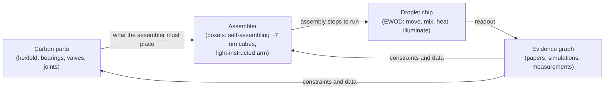
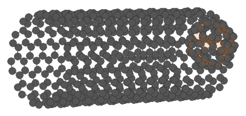
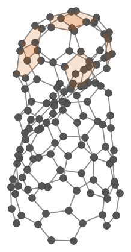
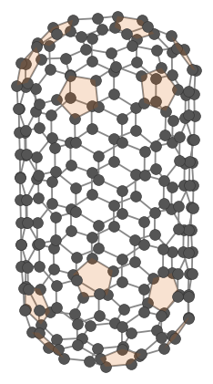
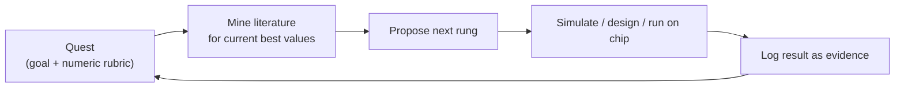

<!-- Hand-written. Figures under assets/molecular-machines/ are generated by
     scripts/guide-figures from the hexfold sources: re-run it, never edit them.
     Numbers carry their date; refresh them when the tools move. -->

# Molecular machines with precis

precis is an open-source research server for AI agents. This page follows one
programme it runs: designing molecular machines, which means carbon parts and the
self-assembling machinery that could build them, with every claim tied to the
literature. The page is updated as the tools advance.

- [What it does](#what-it-does)
- [Why the field is stuck, and what is new here](#whats-new)
- [The design chain: parts, assembler, droplet chip](#design-chain)
- [The research engine: grounded and token-efficient](#research-engine)
- [Safety by design](#safety)
- [Roadmap](#roadmap)
- [Where it goes next](#scaling)
- [Open source](#open-source)

## What it does

AI agents design molecular machines and check every step against what has been
published. They then test the designs on a droplet chip that the same system
designs and drives. The target is graphene-like carbon machine parts, assembled
in water at room temperature by a light-controlled assembler built from
self-assembling cubes about 7 nm across.

*A valve shell: a wide carbon chamber between two capped tubes, written as a
hexfold recipe and built into atoms. Stick preview model, before physical
relaxation.*

## Why the field is stuck, and what is new here

Molecular nanotechnology advances on separate tracks: DNA nanotechnology,
molecular switches, carbon nanomaterials and scanning probes. Each track moves on
its own, and few groups have the breadth to connect them. AI could supply that
breadth, but research agents today tend to be expensive, because they read whole
papers into context, and ungrounded, because nothing ties a proposed design to what
has been measured.

precis takes a different approach in four ways:

1. **Design languages agents can write.** hexfold describes curved carbon as
   defect placement on a hexagonal lattice, the way SMILES describes molecules. A
   part is a short string that can be compared, searched and composed, and its
   atoms follow deterministically. Boxels describe 3D structures as cubes whose DNA
   face codes program which faces bind, so assembly becomes a place-and-route
   problem.
2. **Grounding by construction.** Agents state claims, and each claim links to the
   paragraph of the paper that supports it. A claim without a source is flagged
   instead of written.
3. **Autonomous research loops.** Long-running quests carry numeric targets. Agents
   mine the literature for the current best value, propose the next step and log
   everything they do.
4. **A synthesis path the agents can drive.** The same system designs and routes a
   droplet microfluidics board (electrowetting on dielectric, EWOD). The board
   moves, mixes, heats and illuminates nanolitre droplets under software control.

## The design chain: parts, assembler, droplet chip

### Carbon parts (hexfold)

hexfold builds tubes, caps, fullerenes, nanobuds, Y-junctions and multi-part shells
from short recipes. In production it builds structures of up to about 5,800 atoms
and relaxes them with machine-learned interatomic potentials. Next are the named
test pieces, a T-handle bearing and a rotary ratchet valve, each checked for
clearance, drag and torque.

| | | |
|---|---|---|
|  |  |  |
| A nanobud: a fullerene bonded to a nanotube wall | A capped tube with a necked cap | A lidded capsule from the flat-lid family |

*Rings other than hexagons are shaded: pentagons orange, heptagons and larger
violet. These are the defects a hexfold recipe places.*

### The assembler (boxels)

A boxel is a rigid covalent cage about 7 nm on a side. DNA face codes on its six
walls program which neighbours it binds, and a cassette inside it does the work: a
switch, a photochromic unit or a conjugated bridge. Cascade assembly builds larger
structures in self-terminating stages, with purification between stages. The
long-form design document covers cage chemistry, face codes, a five-cube NOR-gate
proof of concept, and staged go/no-go tests for eight named challenges. It is
written and checked inside precis and cites more than a thousand claim hubs. A
preprint is in preparation.

The assembler is a molecular arm instructed by light alone. Three wavelengths carry
clock, data and reset into a register of photoswitches, and a checksum gates each
command, so an imperfect optical write is detected rather than executed. The
carbon parts above are what it is meant to place.

### The droplet chip (EWOD)

precis designs, places and routes its own EWOD boards, with design-rule checks
throughout. The chip gives agents a way to run assembly steps: dispense, merge,
heat and illuminate droplets, then read fluorescence. The first planned on-chip
step is DNA face-code pairing of two labelled building blocks at
electrowetting-compatible salt, read out by fluorescence and logged back into the
evidence graph.

## The research engine: grounded and token-efficient

- **One small interface.** Seven verbs (get, search, put, edit, delete, tag, link)
  over about sixty kinds of object: papers, patents, drafts, CAD parts, circuit
  boards, molecules, findings.
- **Reads less, finds more.** About 9,000 full-text papers are ingested, about
  1.5 million searchable passages (mid-2026). Each paper carries precomputed
  keywords, summaries and a clustered table of contents, so an agent reads the
  paragraph it needs instead of the whole paper. Fisheye views show one object in
  full with its neighbourhood compressed.
- **Grounded claims.** Claims live as hubs with evidence edges. Drafts cite them
  live, and a published claim can be signed as a nanopublication.
- **A model ladder.** Cheap and local models handle volume, and frontier models
  are used only where they matter.
- **Measured, not asserted.** A planned benchmark compares tokens per accepted
  claim, and the rate of unsupported claims, between this fisheye-context flow and
  whole-paper or plain-RAG baselines, on mid-tier and frontier models.

## Safety by design

The long-term goal, an assembler, calls for safety in the order work is done, not
just in how it is described afterward:

- **Light is the only instruction channel.** The arm acts on light-delivered,
  checksum-gated commands, so turning off the light stops it.
- **Finite lifetime.** Photoswitches fatigue after roughly 10³–10⁴ commands per
  arm. Each arm is a consumable with a known instruction budget.
- **Benign end of life as a design target.** Products should be safe to handle and
  should come apart into harmless pieces after use.
- **Self-replication is out of scope.** The tools automate structure, switching
  and placement. Replication stays out.
- **Auditable AI.** Every agent step and every claim is logged with its evidence,
  so a person can check what autonomous research produced.

## Roadmap

| When | What |
|---|---|
| Spring 2027 | Boxel design-document preprint; hexfold 1.0 package; quest loop documented as a package; public quests |
| Summer 2027 | Grounded-research benchmark; EWOD board v1 moving droplets; bearing and valve designed and simulated |
| Autumn 2027 | On-chip DNA face-code pairing with fluorescence readout, run by agents; face-code simulator checked against published yields |
| Winter 2027/28 | Photoswitch-register protocol simulated on the chip; safety framework published |

## Where it goes next

As AI models improve, generating designs gets cheap and checking them becomes the
bottleneck. precis is built to be the checking layer, and because it is
token-efficient, better models can run more of it for the same cost. Next come
several droplet chips running in parallel overnight, a boxel logic gate, a first
light-instructed arm in droplets, and a library of carbon parts ready to place.

## Open source

All of it is public: the server, hexfold, the figure scripts behind this page, and
(as they are built) the board designs and benchmark data.
[github.com/retospect/precis-mcp](https://github.com/retospect/precis-mcp)
